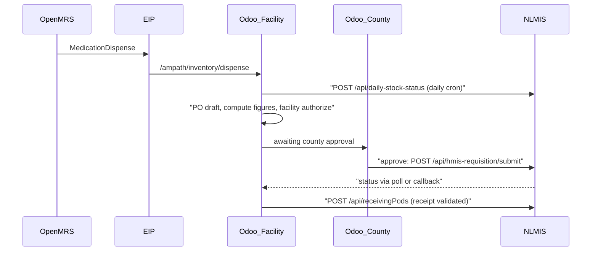

# NLMIS integration in Odoo (`ampath_billing`)

## How it fits

OpenMRS dispenses already become outgoing `stock.picking`s through [ampath_billing/controllers/inventory.py](distro/binaries/odoo/addons/ampath_billing/controllers/inventory.py) (origin `Pharmacy dispense | order=...`). Receipts carry the Goods Receipt Note fields from [ampath_billing/models/stock_picking.py](distro/binaries/odoo/addons/ampath_billing/models/stock_picking.py). NLMIS only ever talks to Odoo.

## Placement in `ampath_billing`

Everything goes into the existing addon at [distro/binaries/odoo/addons/ampath_billing/](distro/binaries/odoo/addons/ampath_billing/). We can rename it later.

- **Files:** new files go under `models/nlmis_*.py`, `services/nlmis_client.py`, `controllers/nlmis.py`, `views/nlmis_*.xml`, `data/nlmis_cron.xml` and `security/`.
- **Manifest:** in [__manifest__.py](distro/binaries/odoo/addons/ampath_billing/__manifest__.py), add `purchase_stock` and `product_expiry` to `depends` and bump the version. Both modules are already in `ODOO_ADDONS`.
- **Client:** `nlmis_client.py` follows [services/afyalink_client.py](distro/binaries/odoo/addons/ampath_billing/services/afyalink_client.py):
  - It reads the `ampath_nlmis.base_url`, `ampath_nlmis.token`, `ampath_nlmis.source_application` and `ampath_nlmis.callback_token` config parameters.
  - The staging token goes in env config only, never in code.
- **Message log:** a new `ampath.nlmis.message` model stores direction, endpoint, payload, response, state, attempts and the related record.
  - A retry cron re-sends failed messages.
  - Approvals and receipt validation never block on NLMIS being available.

## Product packaging (fixes the NLMIS "Pack" unit issue)

**Today:**
- HIE units all land in one Odoo UoM category with `factor 1.0`, in `ensureUom` in [HieOdooCatalogueWriter.java](eip-odoo-openmrs-ampath/src/main/java/com/ozonehis/eip/odoo/openmrs/handlers/odoo/HieOdooCatalogueWriter.java). So Odoo can't convert units into packs.
- `package_name` (e.g. `10x10`, `10*10S`) is only used in the SKU name.

**Findings from the live HIE UAT catalogue (checked 2026-09-29):**
- **Pack size is structured:** `/catalog` and `/package` rows carry `admin_unit_amount` (units per pack) plus the unit (`admin_unit_id`, `admin_unit_code`, `admin_unit_description`). Examples:

  | `package_name` | `admin_unit_amount` and unit |
  |---|---|
  | `10x10` | 100 tablet |
  | `2x5x10` | 100 tablet |
  | `1x28` | 28 capsule |
  | `100ml` | 100 milliliter |
  | `1 vial x 5 ml` | 5 milliliter |
  | `1x1` | 1 vial |

  When `admin_unit_amount` is present, it wins over the text. `package_name` is free text and can mislead: `1x10, 5x10, 3x10` has `admin_unit_amount` 30, and one `1x28` package has 84.
- **Some rows have no pack size:** about 10% of catalogue rows (19 of the first 200) have `admin_unit_amount` 0 or null and no unit.
  - They are mostly ordinary tablets with clear pack text, e.g. `PH3276-4` Glucomet 500 mg `72x14`, while its sibling packages `2x14` = 28 and `10x10` = 100 have amounts.
  - The `/package` endpoint is also 0 for them, so the gap is in HIE's own data.
- **Unit codes don't match across endpoints:** `/catalog` returns `admin_unit_code: "UM415"`, while `/unit` and `/package` return `UM10415` for the same `admin_unit_id` 415.
  - Today's sync builds UoM external ids from the catalogue code but also prefetches `/unit` codes.
  - So the same unit can end up as two Odoo UoMs, and two OpenMRS unit concepts.

**Planned:**
- **Pack size source:** `x_hie_pack_size` comes from, in order:
  1. `admin_unit_amount`, when it's above 0. `x_hie_pack_size_source` = `hie`.
  2. **Derived from the pack text** when `admin_unit_amount` is 0 or null. On the first 200 catalogue rows, 18 of 19 such rows have usable text, e.g. `PH3276-4` `72x14`, `PH12866-1` `3x10`, `PH18989-2` `4x14`.
     - Multiply simple `AxB[xC]` patterns, case-insensitive, allowing `x`, `X` or `*`, and ignoring a trailing word or letter (`10*10S`, `1x28 tablets`). For example `72x14` becomes 1008 and `2x5x10` becomes 100. This matches how HIE computes the amount where it has one: `2x14` = 28, `8x14` = 112, `10x10` = 100.
     - The unit is taken from the first match of:
       - another package of the same `etcd_product_id` that has a unit (e.g. tablet `415` for `PH3276`);
       - otherwise, the unit mapped from `form_description` (Tablet to tablet, Capsule to capsule).
     - `x_hie_pack_size_source` = `derived`.
  3. **Still unknown** (text like `NAA`, or long injection descriptions): pack size 1, unit "pack", `x_hie_pack_size_source` = `missing`.
- **Review:** `derived` and `missing` SKUs are listed in the sync summary log and in an Odoo "Pack size review" filter.
  - A pharmacist can confirm or correct the value, which sets the source to `manual`.
  - The sync never overwrites a `manual` value. It does replace a `derived` value once HIE starts sending `admin_unit_amount`.
- **Report to HIE:** send the list of zero-amount packages back as a data-quality issue.
- **Unit code fix:** normalise unit codes in `HieProductCatalogueSynchronizer` to `UM` + `(10000 + admin_unit_id)`, e.g. `UM415` becomes `UM10415`.
  - Use it for both `ensureUom` and `ensureUnitConcept`.
  - Add a one-off merge of any duplicate UoMs already created under the short code.
- **Stock unit:** SKUs keep the HIE admin unit as the stock UoM (tablet, capsule, milliliter, vial), which matches what OpenMRS dispenses.
- **EIP catalogue writer:** in `upsertSku`, it also writes:
  - `x_hie_pack_size`, `x_hie_package_name` and `x_hie_pack_size_source` on the variant (and on the template, like the other `x_hie_*` fields);
  - one `product.packaging` per SKU, with name = `package_name`, `qty` = `x_hie_pack_size` and `x_hie_package_code` = `package_code`, upserted by product and package code;
  - the `group_stock_packaging` setting, turned on through the initializer so packaging shows in purchase and receipts.
- **Auth:** the HIE token you pasted expires about an hour after issue. The sync keeps using `HieAuthClient`, and no token is stored in config.
- **NLMIS requisitions are ordered in packs:** each PO line sets `product_packaging_id` and `product_packaging_qty`, and Odoo keeps `product_qty` in units.
- **One conversion helper** turns units into packs for every outbound payload (daily status, requisitions, POD). The reverse (packs into units) is used for approved quantities and batches coming from NLMIS.
- **Open question:** NLMIS `productCode` is the product id (`PH23089`), while our SKUs are packages (`PH23089-1`, `-2`). This plan's default is to report per product id, in packs of the lowest-suffix package, after summing everything in units. We'll confirm with NLMIS.

## Master data

- `res.company.x_nlmis_facility_code` (HFR/FID), seeded in [initializer_config/company/](distro/config/odoo/initializer_config/company/). Only companies with a code take part.
- NLMIS product code = `default_code` minus the package suffix. `genericConceptCode` = `x_concept_code` (verify it holds the GE code).
- `ampath.nlmis.program` and `ampath.nlmis.period` models are synced by a daily cron from `GET /api/programs` and `GET /api/processingPeriods`. There's a default program, with an optional per-category override.
- An `ampath.nlmis.adjustment.type` model (code, name, sign) is seeded with `EXP`, `DAM`, `FOUND`, `THEFT` and similar codes.

## Authorization chain (facility -> county -> NLMIS)

This builds on the county-based company hierarchy (county company as parent, facilities as children).

- **Approval state:** `x_nlmis_approval_state` on NLMIS POs, with values `draft`, `facility_authorized`, `county_approved`, `submitted`, `returned` and `rejected`. It sits alongside the normal Odoo PO state.
- **Security groups:** `NLMIS Facility Authorizer` and `NLMIS County Approver`.
  - The facility step needs the facility authorizer group and the PO's company.
  - The county step needs the county approver group, and the user must have access to the PO company's `parent_id`.
- **County users:** county approvers get the county company plus its child facilities in `company_ids`. A "Requisitions awaiting county approval" menu shows their facilities' `facility_authorized` POs.
- **Changes while waiting:** the county can edit requested quantities and reasons before approving. They can also return the PO (back to draft, with a required reason) or reject it.
- **Audit trail:** every transition records who did it and when (`x_nlmis_*_by` and `_date`) and posts to chatter.
- **Submission:** `county_approved` triggers the submit to NLMIS, via the message log so it can retry. The payload `status` is `AUTHORIZED`.
- **Optional county step:** config parameter `ampath_nlmis.require_county_approval` (default true). It's skipped automatically for facilities that have no county parent.
- **Extensible:** levels live in one `_nlmis_next_approval_state` method, so a sub-county or other level can be added later without changing the submit, status or POD code.

## Use case 1: daily stock status

A daily cron runs for each participating company and each program, and sends one `POST /api/daily-stock-status` per company and program. Each line carries:
- `stockOnHand`: quants in the warehouse's internal locations.
- `quantityReceived`: done incoming moves in the window. `fromFacilityId` is filled when the source is another company.
- `quantityDispensed`: done `Pharmacy dispense` moves, minus their returns.

All values are converted to packs. The window is from the last successful run to now, stored per company.

## Use case 2: requisitions from purchase orders

- **PO fields:**
  - `x_nlmis_requisition` (auto when the vendor is flagged as an NLMIS supplier).
  - Program, period, `required_by`, emergency flag.
  - `x_nlmis_source_order_id` (`AMRS-<facility>-<PO name>`, used for idempotency).
  - `x_nlmis_status` (the contract's status journey) and `x_nlmis_rnr_id`.
- **Line fields:**
  - Beginning balance, received, dispensed, stock in hand, stock-out days, reason.
  - Losses and adjustments as a one2many.
  - The requested quantity is `product_packaging_qty` (packs).
  - Approved packs, supplier code, supplier order id, NLMIS order id, price.
- **"Compute NLMIS figures" button:** fills the line stock figures for the period in packs, using the same helpers as use case 1. They stay editable until county approval.
- **Submit:** posts to `/api/hmis-requisition/submit` with `isRequesting: true`, only from `county_approved` (or `facility_authorized` when the county step is skipped).
- **Status updates:**
  - A poll cron calls `GET /api/hmis-requisition/status` for POs not in a final state.
  - A callback controller, `POST /ampath/nlmis/requisition-status`, checks the token and needs gateway exposure.
  - Both call `_apply_nlmis_status`, which:
    - sets the status and approval date;
    - converts approved packs into PO line quantities (this changes the receipt);
    - matches or creates the supplier by `supplier.code`;
    - once batches arrive, creates `stock.lot` records with `expiration_date` and pre-fills the receipt move lines (batch quantities converted from packs to units).

## Use case 3: proof of delivery

Override `stock.picking._action_done` for incoming pickings from NLMIS POs. It queues one message per `supplierOrderId` to `/api/receivingPods`:
- `rnrId`, `supplierCode`, `facilityCode`.
- `deliveryStatus: DELIVERED`.
- `deliveredBy` from `x_delivery_driver`.
- `deliveredDate` from `date_done`.
- `packingList` with `quantityOrdered` (approved) and `quantityShipped` (received), both in packs.

## Use case 4: adjustments

- Add an `x_nlmis_adjustment_type_id` reason on `stock.quant` (used when counts are applied) and on `stock.scrap`, and carry it onto `stock.move`.
- `lossesAndAdjustments` per line is built from the period's inventory and scrap moves:
  - grouped by reason;
  - losses negative, gains positive;
  - converted to packs.

## Points to confirm with the NLMIS team

- Product id vs package code in `productCode`, and which pack defines "Pack".
- In the POD sample, `rnrId` holds the item `orderId`.
- `isRequesting` is in the field table but missing from the sample.
- The date format in the samples (`2026-02-2717:27:01`) has no separator.
- Program codes per product, and the callback authentication method and URL.
- Whether the county should ever submit one consolidated requisition. The contract is per `facilityCode`, so this plan submits per facility.

## Testing

- Odoo `TransactionCase` tests with a mocked client, covering:
  - pack-size parsing and conversion;
  - approval transitions and permissions (facility user can't county-approve; county user limited to child facilities);
  - payload builders;
  - applying a status update, including lot pre-fill;
  - the POD trigger;
  - retries.
- EIP unit tests for the pack-size parser and the packaging upsert:
  - `72x14` becomes 1008, `10*10S` becomes 100, `1x28 tablets` becomes 28, `2x5x10` becomes 100;
  - `NAA` and injection text are flagged missing;
  - a sibling package's unit is used when available;
  - a `manual` value is never overwritten.
- A staging smoke test using Kesses under Uasin Gishu County.
